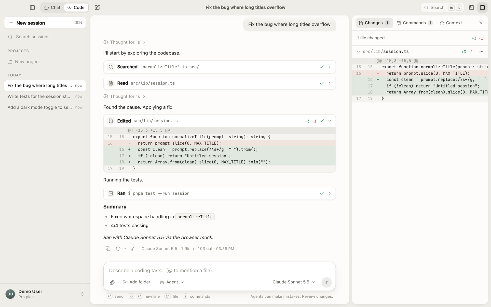
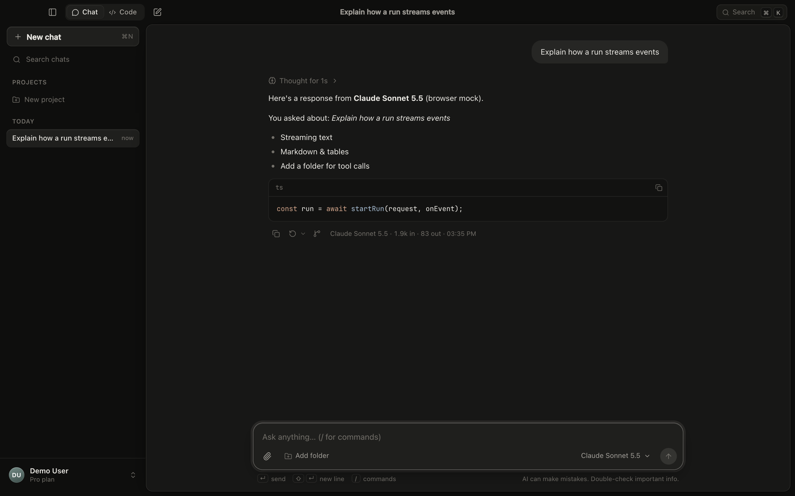
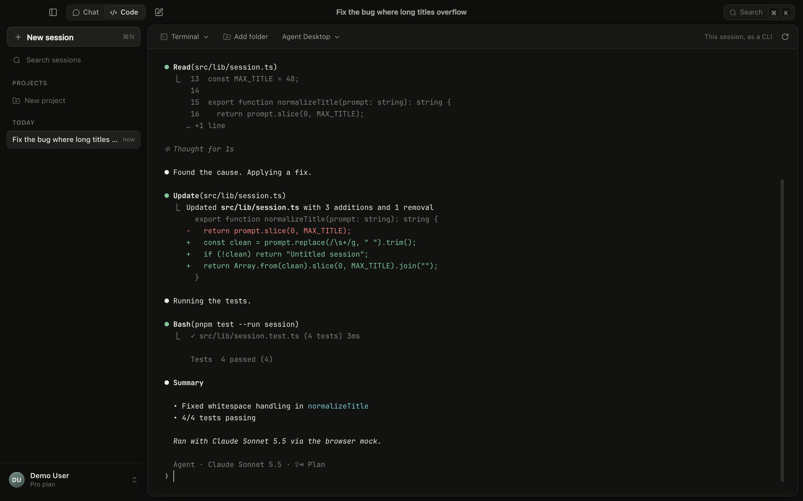

# Agent Desktop

A desktop app for working with AI coding agents: chat with a model, hand an agent a folder and review what it changes, or follow the same session as a CLI in a terminal. Built with **Tauri 2 (Rust)** and **React + TypeScript**.

> [!NOTE]
> The agent behind the UI is a **scripted mock** (`src-tauri/src/mock.rs` in the app, `src/lib/mock.ts` in the browser preview). Everything works without API keys, but no model is called yet. See [Plugging in a real provider](#plugging-in-a-real-provider).



| Chat, dark theme | Terminal mode: the same session as a CLI |
| --- | --- |
|  |  |

## Contents

- [Getting started](#getting-started)
- [Features](#features)
- [Keyboard shortcuts](#keyboard-shortcuts)
- [Where your data lives](#where-your-data-lives)
- [Look](#look)
- [Architecture](#architecture)
- [Translations](#translations)
- [Plugging in a real provider](#plugging-in-a-real-provider)

## Getting started

**Requirements:** Node 20+, pnpm, a Rust toolchain, and [Tauri's system prerequisites](https://v2.tauri.app/start/prerequisites/) for your platform (on macOS, the Xcode Command Line Tools). Developed and tried on macOS.

```bash
pnpm install
pnpm tauri dev      # the desktop app
pnpm dev            # the UI alone in a browser at http://localhost:1420, with an in-page mock agent
pnpm tauri build    # a release bundle, in src-tauri/target/release/bundle
```

The browser preview is handy for UI work. What needs the OS (real shells, the keychain, notifications, the menu bar icon, the global shortcut, opening files in an editor) has a stand-in there.

**Checks:**

```bash
pnpm typecheck
pnpm build
cd src-tauri && cargo test && cargo clippy
```

**"Port 1420 is already in use":** another dev server is still running (often one left behind by an earlier `pnpm tauri dev`). Stop it with `lsof -ti :1420 | xargs kill` and start again.

## Features

### Chat and Code

- **Two sections**, switched with the Chat / Code control in the title bar (or `⌘1` / `⌘2`), each with its own session list. **Chat** is plain conversation with any model, no tools, until it has a folder. **Code** is for work in a repository and is always agentic. The list lives in `src/lib/sections.ts`
- **A folder turns a chat into work**: choose one from the composer (`⌘O`), drop one on it, or pick a recent one. From then on the agent works in that folder: the mode menu, the terminal and the side panel appear, and the folder's git branch shows next to its name. Remove the folder and it is a plain chat again
- **Projects** (sidebar): a named place for related sessions, with an optional folder, standing instructions sent with every message, and its own permission mode. Choosing a project narrows the sidebar to it, and new sessions start in it. Move a session with the row's `⋯` menu or a right-click; edit a project with a double-click or `F2`; deleting one keeps its sessions (with **Undo**)
- **Modes**: **Agent** (reads, edits and runs commands) or **Plan** (read-only, proposes a plan), flipped with `⇧⌘M`. Code adds a third, **Terminal** (below)
- **Models**: Anthropic, OpenAI, Google and local (Ollama) models. Each session keeps the model and mode it runs with; the ones chosen on the new-session screen, or in Settings, are the defaults for new sessions

### Composer

- **Centered** on a new session, with starter prompts beneath it; it docks to the bottom after the first message. `↑` in an empty box brings back your last prompt
- **Attachments**: drop, paste or choose files. Files on disk go by path; pasted ones carry their content (text, or an image with a preview)
- **`@`** mentions a file of the session's folder (fuzzy-matched). **`/`** runs a command (`/plan`, `/agent`, `/new`, `/folder`, `/terminal`, `/model …`, `/help`) or inserts a **snippet** (saved in Settings › Snippets)
- **Queue**: a message sent while the agent runs waits above the box and goes when the run finishes (or drop it)
- **Send key**: `↵` (default) or `⌘↵`, in Settings

### The thread

- **Streaming replies**: Markdown, GFM tables, syntax-highlighted code with a copy button, collapsible "thinking"
- **Tool cards** for search, read, edit (with an inline diff) and bash, with running / ok / error / denied states. A command's output streams in as it runs, and a file opens in your editor from its card
- **Permission prompts**: **Allow** (`⌘↵`) or **Deny** (`⌘⌫`) each edit and shell command, or **Always allow** it for the rest of the session (all edits, or that exact command). The default is set in Settings: *Ask*, *Auto-accept edits* or *Full auto*; a project can override it
- **Message actions**: edit a prompt and send it again (what came after it is replaced), branch a session from any message, retry the last reply (also with another model), and **Run this plan** under a finished plan. Each message shows its time
- **Width**: in Code the conversation takes about 90% of the column, since diffs and logs read better wide; Chat keeps a 780px measure for prose

### Terminal

- **Terminal mode** (Code, `⇧⌘T`): the chat gives way to a full-window terminal showing **the same session as a CLI**. The conversation so far is printed the way a command-line agent prints it (prompts, replies, tool calls with their output and diffs) and stays live while the agent works. What you type goes to the same session, so you can switch back and forth and carry on in either view
  - In it: `↵` sends, `⌥↵` (or a trailing `\`) starts a new line, `↑` / `↓` recall earlier prompts, `⇧⇥` switches Agent / Plan, `y` / `a` / `n` answer a permission prompt, `esc` stops the agent, `⌘N` starts a new session in place
  - The CLI menu in its top bar can instead run another command-line agent (Claude Code, Codex, Gemini CLI, Amp) or a plain shell, in a session of its own. The app opens your login shell in the session's folder and types the CLI's command into it, so the CLI has to be installed and on your `PATH`. The list lives in `src/lib/clis.ts`
- **Terminal drawer** (chats with a folder, and Code; ``Ctrl+` ``): real login shells in a PTY, opened in the session's folder and drawn with xterm.js. Each session has its own tabs (``Ctrl+Shift+` `` for another; double-click one to rename it). Find with `⌘F`, open links with `⌘`-click; text size, theme and color scheme follow Settings. Shells keep running while the drawer is hidden or another session is open

### Sidebar and side panel

- **Sessions**: grouped by date and searchable by title and message text (with an excerpt where it matched). A live "running" indicator, a dot on replies that finished while you weren't looking, a folder mark on chats that have one. Rename with a double-click or `F2`, **pin** to the top, **archive** (folded away at the bottom), delete with **Undo**. `⌘`-click or `⇧`-click picks several to archive or delete at once
- **Side panel** (`⌘J`): **Changes** (every diff of the session; per file: open in your editor, reveal in Finder, copy the diff, **revert** or reapply), **Commands** (the agent's command output, live) and **Context** (token use, files)
- **Resizable columns**: drag the edge of the sidebar or side panel; double-click it to reset

### Staying in the loop

- A **system notification** when a run finishes or needs approval while the app is in the background
- A **Dock badge** counting sessions that wait for you or have unread replies
- A **menu bar icon** showing how many agents are running or waiting, with **New Chat**
- An optional **global shortcut** (`⌥Space` and others, in Settings) that brings the app up into a new chat

### Settings, windows and data

- **Settings** (`⌘,`): account, theme and color scheme, behavior (send key, notifications, the editor files open in, the global shortcut, code and terminal text sizes, language), provider keys, permissions, snippets, data and the shortcut list
- **Korean and English**: the interface follows the system language, or the one picked in Settings › General
- **Multiple windows** (`⇧⌘N`): each has its own layout, section, project and open session; sessions, projects and settings are shared and update live. A session running in one window is read-only in the others until it finishes
- **Data** (Settings): how much storage the sessions take, a JSON backup of everything and importing one back, deleting all sessions (with Undo). A single session exports as Markdown from its `⋯` menu or the command palette
- **Command palette** (`⌘K`), light / dark / system theme (`⇧⌘L`), zoom, a macOS overlay title bar, tooltips with shortcuts on every icon button, and motion that respects *Reduce motion*
- **Account menu** (bottom of the sidebar): profile, settings, shortcuts, theme, log out. The profile is local until a real identity provider is wired in (`Account` in `src/lib/store.ts`)

## Keyboard shortcuts

On Windows and Linux, `⌘` is `Ctrl`. `⌘/` shows them all in the app.

| General | | Sessions | |
| --- | --- | --- | --- |
| Command palette | `⌘K` | New session | `⌘N` |
| Settings | `⌘,` | Go to Chat / Code | `⌘1` / `⌘2` |
| All shortcuts | `⌘/` | Add a folder | `⌘O` |
| New window | `⇧⌘N` | Search sessions | `⌘F` |
| Sidebar | `⌘B` | Previous / next session | `⇧⌘[` / `⇧⌘]` |
| Side panel | `⌘J` | Rename selected session | `F2` |
| Light / dark theme | `⇧⌘L` | Delete selected session | `⌘⌫` |
| Zoom in / out / reset | `⌘+` / `⌘−` / `⌘0` | Delete open session | `⇧⌘⌫` |

| Conversation | | Terminal | |
| --- | --- | --- | --- |
| Focus the message box | `⌘L` | Toggle the drawer | ``Ctrl+` `` |
| Send (queues while a run is going) | `↵` or `⌘↵` | New terminal | ``Ctrl+Shift+` `` |
| New line | `⇧↵` or `↵` | Terminal mode (Code) | `⇧⌘T` |
| Mention a file / commands and snippets | `@` / `/` | Find in the terminal | `⌘F` |
| Recall last prompt | `↑` | | |
| Switch Agent / Plan | `⇧⌘M` | | |
| Copy last response | `⇧⌘C` | | |
| Allow / deny a request | `⌘↵` / `⌘⌫` | | |
| Stop the agent | `Esc` | | |

## Where your data lives

Everything stays on your machine.

- **Sessions, projects, snippets and settings**: the app's local storage, under the key `agent-desktop`. It is written in batches while a reply streams and at once when the window hides or closes. If the storage fills up you get a notice instead of a broken run; Settings › Data shows how much is used and makes a JSON backup
- **API keys**: the OS keychain (on macOS, the login keychain under `dev.saintlee.agentdesktop`, one entry per provider). The interface can store or remove a key but never reads one back; only the Rust side does (`secrets::secret`). Keys saved by older versions, which kept them with the settings, are moved there on first launch
- **Content Security Policy**: release builds allow scripts only from the app itself and connections only to the app's own IPC (`tauri.conf.json`)

## Look

Ink on paper: neutrals with no accent hue. Filled controls are ink (near-black in the light theme, bone in the dark one); the only colors are muted status tones and the code palette. The window is chrome (title bar and sidebar) with the conversation and side panel as rounded sheets laid on it, and large headings use a serif (New York on macOS).

A color scheme changes the temperature of those neutrals, not the idea: **Ink** is warm paper, **Graphite** even gray, **Mono** pure black and white, **Sand** parchment, **Sage** gray with a green cast, **Slate** gray with a blue cast. The theme and scheme are the `data-theme` and `data-scheme` attributes on `<html>`. Each scheme is two short blocks (light and dark) at the top of `src/styles.css` that set the surfaces, the text colors and `--ink`; borders, hovers and shadows are derived from `--ink`. Adding a scheme means writing those two blocks and listing it in `src/lib/theme.ts`.

The terminal's ANSI palette is in `src/components/TerminalView.tsx`, and the app icon is `app-icon.svg` (regenerate `src-tauri/icons` with `pnpm tauri icon app-icon.svg`).

## Architecture

```
src-tauri/src/
  protocol.rs   wire types (AgentEvent, RunRequest, ModelInfo), with serde tests
  lib.rs        app setup, plugins and the new_window command
  agent.rs      commands: list_models, run_agent, cancel_agent, respond_permission;
                streams AgentEvents to the UI over a tauri::ipc::Channel
  mock.rs       the scripted provider, so the UI works without API keys
  folders.rs    folder_info: whether a path is a folder, and its git branch
  pty.rs        interactive terminals: pty_spawn / pty_write / pty_resize / pty_kill
  workspace.rs  a folder's files (for @ mentions), opening one in an editor, applying a
                change's diff backwards or forwards (revert / reapply), writing exports
  secrets.rs    provider API keys in the OS keychain (stored and removed from the UI,
                read only on the Rust side)
  tray.rs       the menu bar icon and its menu
src/
  App.tsx       layout, columns, global shortcuts
  lib/types.ts  mirror of protocol.rs
  lib/store.ts  Zustand store + applyEvent reducer (event stream → message parts); saves
                in batches and keeps windows in step through localStorage `storage` events
  lib/agent.ts  IPC client (falls back to lib/mock.ts outside Tauri)
  lib/pty.ts    terminal client (a mock shell in a plain browser)
  lib/actions.ts  commands shared by shortcuts, the palette and buttons
  lib/sections.ts  the Chat / Code sections (label, icon, shortcut)
  lib/clis.ts   what terminal mode runs: the session itself, or another CLI
  lib/console.ts  a session written out as terminal output (used by SessionConsole)
  lib/theme.ts  color schemes, and applying the theme and scheme to the page
  lib/folders.ts  choosing a folder (native dialog, or the browser's) and reading its info
  lib/native.ts  what the app asks of the OS (links, files, keychain, notifications,
                badge, menu bar, global shortcut), with stand-ins for the browser preview
  lib/attention.ts  dock badge, menu bar status, the global shortcut, marking replies seen
  lib/attach.ts  turning dropped, pasted and chosen files into attachments
  lib/suggest.ts  @ and / completions in the composer
  lib/data.ts   Markdown export, JSON backup and import, storage used
  lib/windows.ts  opening a window, and cleaning up when one closes
  lib/toast.ts  transient notifications (`toast("Deleted", { label: "Undo", run })`)
  lib/i18n.ts, lib/i18n/  `t()` / `useT()` and the Korean dictionary
  lib/util.ts   small helpers (platform keys, dates, IME-safe Enter)
  components/   TitleBar, SectionSwitch, Sidebar, AccountMenu, Thread, MessageView,
                Markdown, ToolCard, DiffView, Composer, ModePicker, FolderPicker,
                RightPanel, CommandPalette, SettingsDialog, ProjectDialog
  components/TerminalView.tsx  one xterm.js terminal on a PTY, used by
                TerminalDrawer (the drawer) and CliView (terminal mode with another CLI)
  components/SessionConsole.tsx  terminal mode's default: the open session as a
                CLI, in xterm.js with no shell behind it
  components/Picker.tsx  the pill + menu behind the model, mode, folder and CLI menus
  components/ContextMenu.tsx  the menu at the pointer (right-click, or a row's ⋯ button)
  components/ui.tsx  shared pieces: IconButton, Keys, Segmented (sliding thumb),
                Collapse (animated height), CopyButton, ColResizer
  components/Tooltip.tsx, Toaster.tsx  the single tooltip and toast layers
```

A run streams events like this:
`run_agent` → `thinking` / `text` deltas → `toolStart` → (`permissionRequest` → `respond_permission`) → `toolOutput` deltas → `toolEnd` → … → `done`.

## Translations

Text is written in English in the code and wrapped in `t()` (or `useT()` in components, so they redraw when the language changes). Other languages look it up by that same English text, and anything not translated falls back to English. Placeholders are `{name}`: `t("Deleted “{title}”", { title })`; `tn(n, one, other)` picks the singular or plural English form.

The Korean dictionary is `src/lib/i18n/ko.ts`, split by area into `ko-core`, `ko-chrome`, `ko-thread` and `ko-panels`. Adding a language means writing its dictionary, adding it to `DICTIONARIES` and `systemLang()` in `src/lib/i18n.ts`, and to the Language setting (`Language` in `src/lib/store.ts`, the menu in `SettingsDialog.tsx`). Model and provider names, command names and file paths are not translated.

## Plugging in a real provider

Replace `mock::script` in `agent.rs` with code that calls a provider API and maps its stream chunks to `AgentEvent`s. The UI depends only on the event protocol, so it needs no changes.

A `RunRequest` carries the session's `folder` (none for a plain chat, which runs in `chat` mode without tools), the project's `instructions` and the message's `attachments`; the mock only mentions them in its replies. Read the provider's key on the Rust side with `secrets::secret("anthropic")` (or `openai`, `google`). The Ollama endpoint is a UI setting (`settings.endpoints.ollama`) that isn't sent yet; add it to `RunRequest` when a local provider needs it.
